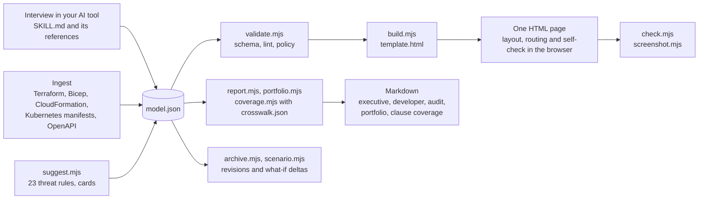

# NetBlueprint Forge

Interview-driven threat modelling that produces a validated context model, a self-contained interactive diagram, and clause-level framework coverage an auditor can use.

[](https://github.com/digitalprezllc/netblueprint-forge/actions/workflows/checks.yml) [](https://github.com/digitalprezllc/netblueprint-forge/releases) [](LICENSE) [](#installation-and-prerequisites) [](https://agentskills.io/specification) [](https://github.com/digitalprezllc/netblueprint-forge/issues)

Architecture diagrams rarely say who authenticates how, which threats apply, which controls exist, or what an assessor can tick off, and the tools that do model threats usually stop at identification and keep the model inside their own server. NetBlueprint Forge is an [Agent Skill](https://agentskills.io/specification) for Claude Code, Cursor, Kiro and the other tools that read the standard: it interviews you about a network or an application, writes one JSON model, and from that model renders an interactive HTML page, runs 23 threat rules, enforces a policy in CI, and reports which controls and requirements touch which clause of ISO 27001, PCI DSS, SOC 2, HIPAA, NIST CSF, NIST SP 800-53, NIST SP 800-171 and CMMC. It is built for security architects, platform teams, auditors and the consultancies that serve them. Nothing leaves your machine: the scripts make no network calls, and a rendered page has no external dependency, not even a font.


*The primary example, [Contoso partner portal published through Microsoft Entra Application Proxy](examples/entra-app-proxy/README.md), opened at step 5 of its story. [Open the live page](https://bifrost.digitalprez.com/download/netblueprint-forge/entra-app-proxy/entra-app-proxy.html#step=5).*

## Contents

- [Core capabilities](#core-capabilities)
- [See it: the examples](#see-it-the-examples)
- [Architecture and workflow](#architecture-and-workflow)
- [What the model holds](#what-the-model-holds)
- [Threats, controls and coverage](#threats-controls-and-coverage)
- [The page](#the-page)
- [Installation and prerequisites](#installation-and-prerequisites)
- [Quickstart](#quickstart)
- [Using the skill](#using-the-skill)
- [Configuration reference](#configuration-reference)
- [Quality checks](#quality-checks)
- [Security and vulnerability disclosure](#security-and-vulnerability-disclosure)
- [Governance and contributing](#governance-and-contributing)
- [Documentation](#documentation)
- [Repository layout](#repository-layout)
- [License and commercial licensing](#license-and-commercial-licensing)

## Core capabilities

- **Compliance coverage by clause, not by checkbox.** Controls and requirements cite the clauses they serve, and a working crosswalk from NIST SP 800-53 Rev. 5 derives the rest for ISO/IEC 27001:2022, PCI DSS 4.0, SOC 2, the HIPAA Security Rule, NIST CSF 2.0, NIST SP 800-171 Rev. 2 and CMMC 2.0 Level 1 and 2. The Threat Register shows what the model cites, `coverage.mjs` answers "which controls touch CMMC AC.L2-3.1.12 here" with the gaps, and the audit report lists verified controls with their evidence. Derived rows are marked as derived, and every output says that touching a clause is not satisfying it.
- **Threat modelling that runs to the end.** STRIDE, LINDDUN, ATT&CK, CAPEC and CWE classification; an adversary profile; inherent, current and projected ratings by Likelihood × Impact, OWASP Risk Rating or CVSS; controls as shared objects with status, owner, due date and evidence; requirements with permanent numbers; attack paths walked hop by hop on the canvas; what-if scenarios with a computed delta; executive, developer and audit reports; a portfolio table across models.
- **A model the validator holds to account.** One JSON file, written by name and never by coordinates, checked against a JSON Schema and a cross-reference lint: a mitigated threat needs an implemented control, an accepted risk needs its acceptance record, every flow carries a data classification. `settings.policy` says what `validate --strict` fails on, so CI gates on the model with one command, and every revision is archived with a changelog entry.
- **Output that lasts and travels.** One HTML file per document with the model embedded: no server, no dependency, no network call. Tabs for several diagrams of one system, a searchable Threat Register across all of them, deep links to a tab, a step or an attack-path hop, the official Azure, AWS and Google Cloud icons, and a geometry check the page runs on itself.
- **Knowledge for the domains you actually model.** Cards with dependencies, exposure questions, proposals and threats for 36 cloud services, 21 self-managed components, Kubernetes, AI systems with OWASP LLM and MITRE ATLAS references, and OT with IEC 62443 zones, conduits and security levels; ingest from Terraform, Bicep, CloudFormation, Kubernetes manifests and OpenAPI.
- **Open standard, your tools, your data.** The skill is a folder with a `SKILL.md`, installable into every tool that reads Agent Skills; the scripts are Node.js with no dependencies; the release archive is deterministic, so a version has one hash locally and in CI; a `frameworks.json` beside a model, custom fields and custom layers extend the shipped vocabulary without forking it.

## See it: the examples

Five documents ship with the skill, each adapted from a public reference architecture and set at the vendor's own sample organization: Microsoft's Contoso, AWS's AnyCompany, Google's Cymbal. Every page is one HTML file: the **live** links open it rendered, in your browser; the **source** links show the same file in the repository, where GitHub displays its markup (download it or clone to open it locally).

| Example |
| - |
| **Entra Application Proxy** (the primary example)<br>A partner opens a portal that lives deep inside Contoso's network, and nobody opened a firewall port to let them in. The request pre-authenticates at Entra ID, rides an outbound connector tunnel, picks up a Kerberos ticket over ExpressRoute and lands on an IIS site beside its SQL server, while a bad actor tries the same door and is turned away. Service profiles on every server, full detail on every flow, four threats with as-is and future-state controls, and the out-of-scope pieces drawn greyed.<br>[live](https://bifrost.digitalprez.com/download/netblueprint-forge/entra-app-proxy/entra-app-proxy.html) · [source](examples/entra-app-proxy/entra-app-proxy.html) · [model](examples/entra-app-proxy/entra-app-proxy.model.json) · [README](examples/entra-app-proxy/README.md) · [picture](docs/images/entra-app-proxy.png) |
| **Azure hub-spoke** (two tabs)<br>Contoso's web workload behind an Application Gateway WAF, with App Service, Azure SQL and Key Vault on private endpoints and administrators arriving through Bastion from on-premises. The **Baseline** tab walks attack path AP-0001, where a drifted NSG rule exposes the jump VM and a saved database connection turns a foothold into exfiltration. The **What-If** tab drops a public Redis cache into the same design and shows what it costs: two new threats, three new controls and a second path.<br>[live](https://bifrost.digitalprez.com/download/netblueprint-forge/azure-hub-spoke/azure-hub-spoke.html) · [source](examples/azure-hub-spoke/azure-hub-spoke.html) · [model](examples/azure-hub-spoke/azure-hub-spoke.model.json) · [README](examples/azure-hub-spoke/README.md) · pictures: [attack path](docs/images/azure-hub-spoke-attack-path.png), [what-if](docs/images/azure-hub-spoke-whatif.png), [register](docs/images/threat-register.png) |
| **Partner Portal: Access Paths** (two tabs)<br>The same portal drawn twice in one document. **Partner Access** is the published path; **Admin Access** is how IT maintains the connector servers, from a privileged workstation through a jump host behind its own ACL, with the direct RDP shortcut from the office dropped at the application boundary. Threat numbers run on across the tabs and one register lists both diagrams.<br>[live](https://bifrost.digitalprez.com/download/netblueprint-forge/partner-portal-tabs/partner-portal-tabs.html) · [source](examples/partner-portal-tabs/partner-portal-tabs.html) · [model](examples/partner-portal-tabs/partner-portal-tabs.model.json) · [README](examples/partner-portal-tabs/README.md) · [picture](docs/images/partner-portal-admin-access.png) |
| **AnyCompany on AWS**<br>A three-tier web application in a VPC, adapted from the AWS Architecture Center. CloudFront and AWS WAF stand at the edge, an Application Load Balancer sits in public subnets, EC2 in private ones and RDS in isolated ones; Secrets Manager, S3 and CloudWatch are reached over VPC endpoints, and operators use Session Manager instead of SSH. Six threats and attack path AP-0001, from an SSRF against the instance metadata service to role credentials and on to the database, with AWS's own icons on every service, subnet and gateway.<br>[live](https://bifrost.digitalprez.com/download/netblueprint-forge/aws-three-tier/aws-three-tier.html) · [source](examples/aws-three-tier/aws-three-tier.html) · [model](examples/aws-three-tier/aws-three-tier.model.json) · [README](examples/aws-three-tier/README.md) · [picture](docs/images/aws-three-tier.png) |
| **Cymbal on Google Cloud**<br>A serverless storefront, adapted from the Cloud Architecture Center. A global load balancer with Cloud Armor fronts the Cloud Run services, a Serverless VPC Access connector leads to Cloud SQL and Memorystore on private addresses, and Secret Manager, Cloud Storage, Identity-Aware Proxy for the admin console and a VPC Service Controls perimeter complete the picture. Six threats and attack path AP-0001, where a compromised dependency in the Orders API reaches the secrets and then the customer data, with Google Cloud icons throughout.<br>[live](https://bifrost.digitalprez.com/download/netblueprint-forge/gcp-serverless-web/gcp-serverless-web.html) · [source](examples/gcp-serverless-web/gcp-serverless-web.html) · [model](examples/gcp-serverless-web/gcp-serverless-web.model.json) · [README](examples/gcp-serverless-web/README.md) · [picture](docs/images/gcp-serverless-web.png) |


*Attack path AP-0001 on the hub-spoke Baseline, hop 2 of 3. Each path is a red phase at the end of the walkthrough; Next walks its hops.*


*The What-If tab: the proposed Redis cache with its public endpoint, evaluated beside the untouched baseline. `scenario.mjs` prints the delta between the two.*

| Threat Register | A second tab of one document |
| - | - |
|  |  |
| Every threat and attack path of the document, across tabs, with inherent, current and projected ratings and the controls that apply; the eye buttons in the register's head show or hide each section, and Requirements and Framework Coverage start hidden. A row opens the threat on its diagram. | Admin Access, the second diagram of the Partner Portal document, at its Broker step. Tabs sit under the canvas; the register is always the last one. |

Every picture above is the whole page at the diagram's natural size, taken from the built examples by `tests/readme_screenshots.mjs` (see [Quality checks](#quality-checks)). Deep links open a page at a point, for a colleague or a picture: [the what-if tab at its cache step](https://bifrost.digitalprez.com/download/netblueprint-forge/azure-hub-spoke/azure-hub-spoke.html#tab=whatif-redis&step=6) (`#tab=whatif-redis&step=6`), [attack path AP-0001 at hop 2](https://bifrost.digitalprez.com/download/netblueprint-forge/azure-hub-spoke/azure-hub-spoke.html#path=AP-0001&hop=2) (`#path=AP-0001&hop=2`).

## Architecture and workflow

One model drives everything. The interview, or an ingest of infrastructure code, produces `model.json`; the validator checks it against the schema, the cross-reference lint and the model's own policy; the build script embeds it in the renderer template, and the page lays itself out in the browser. The same model feeds the threat rules, the reports and the coverage script, so the diagram, the register, the audit evidence and the clause coverage never disagree. Every script is Node.js with no dependencies and no network access.



Three artefacts, in this order:

1. **The conversation.** The skill runs a sectioned interview ([references/interview.md](skills/netblueprint-forge/references/interview.md)): what is being modelled, one diagram or several tabs, the network shape and its zones, the boundaries and their appliances, nodes and the services on them, users, devices and actors, flows and how each side authenticates, the story in phases and steps, threats and controls, attack paths, layers, then the summary and signature. Mandatory prompts are few (title and author, zones, nodes; for a threat: title, STRIDE, a target, adversary type, risk method and its inputs); everything else is optional and skippable. Typed answers are matched to option lists with `normalize.mjs` and confirmed when the match is unsure. Two other ways in: **ingest** Terraform, Bicep, CloudFormation, Kubernetes manifests, OpenAPI documents or a design document into proposed elements ([references/ingest.md](skills/netblueprint-forge/references/ingest.md)), and **what-if**, where a proposed change becomes a scenario tab derived from the baseline, never an edit of it ([references/what-if.md](skills/netblueprint-forge/references/what-if.md)).

2. **The model** (`model.json`), validated against a [JSON Schema](skills/netblueprint-forge/assets/schema/netblueprint.schema.json) and a cross-reference lint. Names are ids and every reference is by name; there are no coordinates, only optional layout hints. Abridged from the examples (the attack path comes from the hub-spoke document):

   ```json
   {
     "meta": { "title": "Contoso Partner Portal Published Through Microsoft Entra Application Proxy", "author": "DigitalPrez, LLC", "version": "1.2.0" },
     "zones": [
       { "name": "connector-vnet", "label": "Connector VNet", "parent": "azure", "kind": "vpc",
         "appliances": [ { "name": "nsg-connectors", "label": "NSG", "type": "firewall", "edge": "left", "serves": ["internet"] } ] }
     ],
     "nodes": [
       { "name": "partner", "label": "Partner User", "type": "remote-user", "zone": "internet" },
       { "name": "portal-app", "label": "Partner Portal (Internal Web App)", "type": "host", "zone": "app-segment",
         "components": [ { "name": "web", "label": "Portal Site (IIS)" }, { "name": "reports", "label": "Legacy Reports Module" } ] }
     ],
     "flows": [
       { "name": "f-employee-app", "label": "Internal Access", "from": "employee", "to": "portal-app/web", "kind": "data",
         "auth": "kerberos", "protocol": "HTTPS", "port": "443/tcp", "encrypted": true,
         "data_classification": "restricted", "data_tags": ["pii"] }
     ],
     "steps": [
       { "name": "request", "phase": "connect", "title": "A partner opens the portal's external address",
         "flows": ["f-partner-proxy"], "highlight": ["partner"] }
     ],
     "threats": [
       { "id": "THR-0001", "number": 1, "title": "Credential Stuffing and MFA Fatigue Against Partner Accounts", "status": "open",
         "classification": { "stride": ["spoofing"] }, "targets": [ { "kind": "flow", "ref": "f-attacker-entra" } ],
         "risk": { "method": "likelihood-impact", "likelihood": "high", "impact": "high",
                   "residual": { "method": "likelihood-impact", "likelihood": "low", "impact": "high" } },
         "treatment": { "decision": "mitigate", "controls": ["CTL-0001", "CTL-0002"] } }
     ],
     "controls": [
       { "id": "CTL-0001", "name": "Conditional Access: MFA and No Legacy Auth for B2B Guests", "type": "preventive", "status": "verified",
         "implemented_on": [ { "kind": "node", "ref": "entra-id" } ], "nist_800_53": ["IA-2(1)"] }
     ],
     "attack_paths": [
       { "id": "AP-0001", "number": 1, "title": "Exposed Jump Host to Database Exfiltration",
         "hops": [ { "threat": "THR-0004", "via": "f-attacker-jump", "to": "jump-vm", "gain": "foothold" },
                   { "threat": "THR-0005", "via": "f-jump-sql", "to": "sql", "gain": "data-access" } ],
         "breaks_at": ["CTL-0008", "CTL-0010"] }
     ]
   }
   ```

   Every field, its allowed values and its rules are in the generated [model reference](skills/netblueprint-forge/references/model-reference.md). Node types: server, host, service, database, storage, api, connector, saas, public-endpoint, user, remote-user, admin, bad-actor, laptop, workstation, mobile, iot, ot, identity-provider, generic. A model can be one diagram or `tabs[]`, each tab with its own collections; a scenario tab names its baseline and the change.

3. **The page** (`<model-name>.html`), built by `build.mjs` from the [renderer template](skills/netblueprint-forge/assets/template/template.html) with the model embedded. The renderer places zones, nodes and appliances, locks partners of the story onto common centre lines, routes every line with an orthogonal visibility-graph search under a written precedence (no line through a box, none over text, glyphs on clear spans, bars crossed where the search decides), then checks its own geometry. How and why is in [docs/research/layout-routing.md](docs/research/layout-routing.md) and [references/layout-hints.md](skills/netblueprint-forge/references/layout-hints.md).

Models are revised by name: archive first (`archive.mjs` snapshots the model and page, bumps the version, opens a changelog entry), edit, validate, build, log the diff. Threat and attack-path numbers are permanent: retired, never deleted or renumbered.

## What the model holds

A page is not a drawing with notes attached. Every element carries the attributes an architect, an auditor and an attacker care about, the validator checks them, and the page shows them on a click.

- **Flows are more than arrows.** Each one records its kind (data, control, auth, token, trust, blocked, tunnel, dependency), who initiates it and how the session is held, protocol and port, the transport and what it provides (confidentiality, integrity, server or mutual authentication, forward secrecy, replay protection, certificate validation), how the client and the server authenticate (method, factors, MFA type, where the credential lives and how it rotates; certificate issuer, key storage, pinning), the controls on the path (logging and its destination, rate limiting, input validation, DLP, TLS and WAF inspection), availability (timeout, retries, single point of failure), a data classification band, a TLP marking and the labels a review turns on: PII, PHI, PCI, financial, NPI, MNPI, FCI, CUI, export-controlled, credentials, trade secrets.
- **Elements carry a service profile.** Business and technical owners, team, cost centre and support tier; platform, OS, runtime, version, support status and end of life; hosting, site, region, availability zone, country and data residency; device authentication (factors, methods, assurance level, credential storage); elevated access (model, MFA and whether it is phishing-resistant, pathway, local admin, session recording); patching responsibility, cadence and SLA days by severity, KEV included; hardening baseline, who verified it and the exceptions; software sourcing (COTS, open source, custom, SaaS), vendor, version, licensed support and whether an SBOM exists.
- **Threats are classified and attributed.** STRIDE, LINDDUN for privacy, ATT&CK tactics and techniques, CAPEC and CWE; the targets, the boundary crossed, the assets and data at risk; an adversary profile in NIST SP 800-30 and STIX terms (type, source class, motivation, capability, intent, targeting, resources, position, privileges required, access vector); three ratings, inherent, current and projected, by Likelihood × Impact or the OWASP Risk Rating, with CVSS 3.1 or 4.0 beside them; mappings to OWASP, NIST SP 800-53, CIS Controls and ISO 27001; a treatment decision with the controls in place and planned, a risk acceptance with approver and review date when the decision is to accept; and provenance, how the threat was found and when.
- **Controls are objects of their own,** shared between threats: type, a status that runs from proposed to verified with the verification method and date, effectiveness, owner, due date, ticket, the elements they are implemented on, NIST SP 800-53, CIS Controls and ISO 27001 references, ATT&CK mitigations and D3FEND techniques, clauses of other frameworks, and evidence records that say what showed the control works. The validator holds the line: a mitigated threat needs an implemented control, an accepted one needs its acceptance record, an overdue control is flagged.
- **Requirements close the loop.** `REQ-nnnn` objects with permanent numbers state what must hold, name the threats they answer, the controls that satisfy them and the framework clauses they serve; an implemented requirement rests on a real control. The register lists them beside the threats.
- **Dependencies are structure.** Every node, component and appliance lists what it needs to work (identity, DNS, certificates, keys, secrets, logging, time, a package registry) with the provider on the diagram, drawn as a dashed dependency flow on its own layer; the validator asks for the flow when it is missing.
- **Policy travels with the model.** `settings.policy` says what `validate --strict` fails on (an open high threat with no planned control on track, a missing treatment decision, an overdue control, a requirement without a control, a suggested element, an accepted risk past its review date), so CI gates on the model with one command. Organisation metadata that fits no field goes in `custom`.
- **Stories make the model readable.** A guided walk through the flows, step by step; attack paths as chains of hops that name the threat, the flow it rides, where it lands, what the adversary gains and which controls it bypasses, with the controls that break the path, walked on the canvas as a red phase; what-if scenarios as tabs derived from a baseline, with a computed delta of what moved; a signature block with prepared, reviewed and approved by, status and classification.
- **Frameworks by clause.** Controls and requirements cite the clauses they serve (ISO 27001, PCI DSS, SOC 2, HIPAA, NIST CSF, NIST SP 800-53, NIST SP 800-171, CMMC, your own); the shipped crosswalk derives the rest from NIST SP 800-53 ids, marked as derived; the register shows what cites each clause and `coverage.mjs` answers "which controls satisfy PCI DSS 8.4.2 here" with the gaps.
- **Output that lasts.** One HTML file with the model embedded: no server, no dependency, no network call, so it opens the same way in ten years. Deep links to a tab, a step or a hop; a Threat Register across every diagram of the document; a geometry check the page runs on itself; a validator that refuses to build a model with errors.

## Threats, controls and coverage

- **A threat** has a permanent id and number, a title, STRIDE categories and ATT&CK tactics, a vulnerability category with its CWE, targets (nodes, flows, zones, appliances, components), the boundary it crosses, the assets and data at risk, an adversary profile, standards mappings and a treatment: mitigate, accept, transfer or avoid, with the controls in place, the controls planned and suggested mitigations written as engineering actions. The catalogue of questions and options is [references/threats.md](skills/netblueprint-forge/references/threats.md).
- **Three ratings, current first.** The skill asks for the controls already in place, rates the risk with them (`risk.residual`, shown on the canvas), then without them (`risk`, inherent), then after the planned controls (`risk.projected`). The method is chosen per threat: Likelihood × Impact, OWASP Risk Rating or CVSS ([references/risk-scoring.md](skills/netblueprint-forge/references/risk-scoring.md)); `validate.mjs --fix` writes the computed rating and score back and flags a rating that contradicts its inputs.
- **Attack paths** chain threats into a cascade: each hop names the threat, the flow it rides, where it lands, what the adversary gains (foothold, credentials, token, session, network access, code execution, data access, data exfiltration, privilege, persistence, lateral movement, denial of service, impact), the controls it bypasses and a note; the path carries its entry point, impact, assets at risk, its own three ratings, the controls that break it and the ATT&CK techniques. The validator checks that the chain is continuous and that each hop's threat is relevant to where it lands.
- **Rules propose, the user confirms.** `suggest.mjs` runs 23 rules over the flows and elements (STRIDE per interaction: unauthenticated or password-only Internet flows, data in the clear, unguarded boundaries, administrative sessions without strong MFA, exposed data stores, deprecated TLS, plaintext credentials, end-of-life platforms) and proposes threats with STRIDE, CWE, ATT&CK, an adversary, a rating and a mitigation; a threat the model already has on the same target is not proposed again; `--apply` writes the rest as suggested threats to confirm or retire. Deterministic, offline, tested on a fixture that triggers every rule.
- **Cards carry the domain knowledge.** Cloud services (12 cards each for AWS, Azure and Google Cloud, with the service's official icon; [references/cloud](skills/netblueprint-forge/references/cloud/README.md)), the common self-managed components from web server to SIEM ([components.md](skills/netblueprint-forge/references/components.md)), Kubernetes clusters, namespaces, ingress, mesh, registry, secrets and workload identity ([kubernetes.md](skills/netblueprint-forge/references/kubernetes.md)), model endpoints, agents with tools, tool servers, vector stores, RAG pipelines and training data with OWASP LLM and MITRE ATLAS references ([ai.md](skills/netblueprint-forge/references/ai.md)), and controllers, HMIs, historians, engineering workstations, the OT DMZ, safety systems, vendor access and protocol gateways with IEC 62443 zones, conduits and security levels ([ot.md](skills/netblueprint-forge/references/ot.md)). Each card asks its exposure questions and proposes zones, nodes and threats that stay marked `suggested` until confirmed.
- **Coverage, derived honestly.** The crosswalk in [assets/frameworks/crosswalk.json](skills/netblueprint-forge/assets/frameworks/crosswalk.json) maps 135 NIST SP 800-53 Rev. 5 controls to the clauses of seven frameworks, with short clause titles for navigation. The SP 800-171 entries follow NIST's own Appendix D mapping, and the CMMC entries carry the Level 2 identifiers over the same 110 requirements and the 15 Level 1 identifiers as 32 CFR Part 170 maps them. It is DigitalPrez's working aid, not a publisher's attestation: the CIS Controls are absent by licence, and an organisation that holds a publisher's mapping puts it in a `frameworks.json` beside its model. Terms are in [THIRD-PARTY-NOTICES.md](THIRD-PARTY-NOTICES.md).
- **Reports for three readers.** `report.mjs` writes the executive summary (risk at a glance, open threats, paths, accepted risks, policy), the developer to-do list (planned controls by owner, unconverted mitigations, open threats with no plan) and the audit evidence view (verified controls with evidence, requirements by framework clause) as Markdown; `portfolio.mjs` puts every model under a folder in one table.

## The page

- **The band** at the top: title and version, Reset / Back / Next, the phase chips (attack paths are red ones at the end), the document summary (objective, flow, path, access, assumptions, out of scope) and the current step with its flows and their authentication strength. Collapse shrinks it to one strip.
- **The canvas**: zones with their boundary appliances drawn as bars on the edge they guard, nodes with their components, cloud services with their vendor's official icon, other products with their logo when one was fetched for the model, Internet-side actors on the left, flows as orthogonal lines that leave the initiator, an auth badge on every flow (lock = strong, dot = moderate, ! = weak or none, ? = unspecified), a red ✕ on paths blocked by design, numbered threat circles on their targets (a mitigated one carries a small green shield), green shields where controls are in place, red numbered hop markers while an attack path is walked. Out-of-scope elements stay on the diagram, greyed.
- **Attributes and layers**: click any zone, node, component, appliance, flow, threat circle or hop and a floating, draggable Attributes card lists every attribute with a filter box; hover anything for a bubble with the essentials. The Layers card holds the built-in layers (zones, boundary appliances, nodes, components, the Internet side, each flow strength, blocked paths, trust relationships, dependencies, threat markers, control badges, auth badges) and the model's own.
- **Threat Register**: the last tab of every document. One sortable, searchable table of every threat and every attack path across the diagrams, with inherent, current and projected ratings; the severity chips in the toolbar filter it and hide bands on the canvas. A row opens the element on its diagram; an eye per section shows or hides it, and Requirements and Framework Coverage start hidden.
- **Tabs, keyboard and links**: a tab strip under the canvas when the model has several diagrams, a What-If tag and a banner with the change statement on a scenario tab; ← → step, R resets, C collapses the band, Esc clears a selection, PageUp / PageDown switch tabs; Ctrl+wheel, double-click and drag zoom and pan. `#tab=<name>`, `&step=<n or name>`, `&path=AP-nnnn&hop=<n>` and `&sections=all` in the URL open the page at a point.
- **Legend and signature block**: the legend lists only what the model uses, grouped under Flows, Authentication, Elements and Threats; the title block shows organization and logo, title, document number, revision, date, prepared / reviewed / approved by, status and classification.

The full list, including what to check after a build and how to fix what you see, is [references/render.md](skills/netblueprint-forge/references/render.md).

## Installation and prerequisites

| Requirement | Notes |
| - | - |
| An AI tool that reads Agent Skills | Claude Code, Cursor or Kiro, or another tool listed in [docs/PLATFORMS.md](docs/PLATFORMS.md) (OpenAI Codex / ChatGPT, GitHub Copilot, Gemini CLI, Windsurf). |
| Node.js 18 or later | For the scripts. No `npm install`: there are no dependencies. CI runs Node 22. |
| Any browser | To open the pages. |
| Chrome, Chromium or Brave (optional) | For the headless geometry check and the PNG export. Microsoft Edge on Windows hands the page to its running instance and prints nothing, so prefer Chrome there. |
| Python 3 with `jsonschema` (optional) | Only for the schema development test. |

**Link the skill into a project or your user profile.** The scripts create links to `skills/netblueprint-forge/` in `.agents/skills/`, `.claude/skills/` and `.kiro/skills/`, which covers every tool above:

```powershell
git clone https://github.com/digitalprezllc/netblueprint-forge.git
cd netblueprint-forge
.\platforms\install.ps1                       # this repository
.\platforms\install.ps1 -Global               # your user profile (~/.agents, ~/.claude, ~/.kiro)
.\platforms\install.ps1 -Target C:\path\to\your\project
```

```bash
git clone https://github.com/digitalprezllc/netblueprint-forge.git
cd netblueprint-forge
./platforms/install.sh                        # this repository
./platforms/install.sh --global               # your user profile
./platforms/install.sh /path/to/your/project
```

`-Copy` / `--copy` copies instead of linking; `-Uninstall` / `--uninstall` removes the links. Or copy the `skills/netblueprint-forge` folder yourself into the folder your tool reads; it carries its own LICENSE.

**Claude Code plugin:**

```text
/plugin marketplace add digitalprezllc/netblueprint-forge
/plugin install netblueprint-forge@netblueprint
```

**From a release archive.** `netblueprint-forge-<version>.zip` is one folder, `netblueprint-forge/`, with SKILL.md, LICENSE, references, scripts and assets inside. Download it from the repository's [Releases page](https://github.com/digitalprezllc/netblueprint-forge/releases) or from [bifrost.digitalprez.com/download/netblueprint-forge/releases/](https://bifrost.digitalprez.com/download/netblueprint-forge/releases/). Upload it as a custom skill in claude.ai or through the Claude API, or unzip it into the folder your tool reads. The release number is the skill version; [CHANGELOG.md](CHANGELOG.md) says what each one holds and records its sha256, and `node platforms/package.mjs` builds the same archive, byte for byte, from any checkout of that version.

## Quickstart

Build an example page, validate its model against its own policy, and ask which controls touch CMMC. From the repository root:

```bash
node skills/netblueprint-forge/scripts/build.mjs examples/azure-hub-spoke/azure-hub-spoke.model.json
```

```text
built examples/azure-hub-spoke/azure-hub-spoke.html (330 KB): 14 zones, 25 nodes, 36 flows, 19 steps, 12 threats, 23 controls, 3 attack paths, 15 vendor icons in 2 tabs (1 what-if)
```

Open `examples/azure-hub-spoke/azure-hub-spoke.html` in a browser: the Baseline tab, the What-If tab and the Threat Register, with Next walking the story and the attack paths.

```bash
node skills/netblueprint-forge/scripts/validate.mjs examples/azure-hub-spoke/azure-hub-spoke.model.json --strict
```

```text
azure-hub-spoke.model.json: valid and within policy with 2 warning(s)
```

```bash
node skills/netblueprint-forge/scripts/coverage.mjs examples/azure-hub-spoke/azure-hub-spoke.model.json --framework cmmc-2.0 --gaps
```

```text
30 clauses touched: 9 verified, 11 implemented, 10 planned, 0 with requirements only; the crosswalk knows 125 clauses of this framework, 95 of them untouched.

| Clause | Title | Controls | Requirements | Coverage |
| IA.L2-3.5.3 | Multifactor authentication for privileged accounts and network access | CTL-0001 (Implemented, via crosswalk); CTL-0002 (Planned, via crosswalk); CTL-0010 (Planned, via crosswalk) |  | implemented |
```

Then, in your AI tool, start a model of your own: "Use netblueprint-forge to model the payments network."

## Using the skill

Ask your AI tool in plain words:

- "Use netblueprint-forge to model the payments network."
- "What if we put a Redis cache in front of the orders database with a public endpoint?" (a what-if tab beside the baseline)
- "Add a second web server `web-02` in `snet-app` and a flow from the gateway to it." (archive, edit by name, rebuild)

The skill writes `netblueprint/<model-name>/model.json`, builds `netblueprint/<model-name>/<model-name>.html` next to it and keeps `archive/` with every earlier revision and a changelog. The scripts can also be run by hand, from the skill folder:

| Command | Does |
| - | - |
| `node scripts/validate.mjs <model.json> --fix` | Schema check plus cross-reference lint; writes computed ratings and Title Case labels back. Exit 1 on errors. |
| `node scripts/validate.mjs <model.json> --strict` | The same, plus the model's `settings.policy`: exit 1 on an open high threat with no plan on track, a missing treatment decision, an overdue control, a requirement without a control, a suggested element. For CI. |
| `node scripts/suggest.mjs <model.json>` | What the 23 threat rules find, each with STRIDE, CWE, ATT&CK, a rating and a mitigation; `--apply` writes them as suggested threats. |
| `node scripts/report.mjs <model.json> --kind exec` | Markdown reports: `exec`, `developer`, `audit` or `all`. |
| `node scripts/portfolio.mjs <folder>` | One table across every model under a folder: threats by band, open high threats, overdue controls, requirements verified, policy and validator results. |
| `node scripts/coverage.mjs <model.json> --framework iso-27001-2022` | Which controls and requirements touch which clause: direct references plus what the crosswalk derives from NIST SP 800-53 ids; `--gaps` lists untouched clauses; `--frameworks` lists the frameworks the crosswalk knows. |
| `node scripts/build.mjs <model.json>` | Validates, then renders `<model-name>.html` next to the model. Refuses a model with errors. |
| `node scripts/archive.mjs <model.json> --note "…"` / `--diff` | Snapshot and version bump before an edit; element-level changelog entry after it. |
| `node scripts/scenario.mjs <model.json> --tab <what-if tab>` | The delta of a what-if tab against its baseline, as Markdown (`--json` for data). |
| `node scripts/check.mjs <page.html>` | Headless geometry check of every tab (needs a Chromium-based browser). |
| `node scripts/screenshot.mjs <page.html> --tab <name> --step <n>` | A PNG of one view, whole page at natural size, for a document or a deck. |
| `node scripts/normalize.mjs <field> "<typed text>"` | Maps an answer onto an option list (STRIDE, bands, protocols); `--fields` lists the fields. |

Details in [scripts/README.md](skills/netblueprint-forge/scripts/README.md).

### A sample session

The skill is the same folder in every tool; only the way you call it differs: automatic on intent or `/netblueprint-forge` in Claude Code, Cursor and Kiro, and the forms in [docs/PLATFORMS.md](docs/PLATFORMS.md) for the others, which also carries two more sample sessions. Output lands in `netblueprint/<model-name>/` in your project whichever tool you use. Here, card data enters at a checkout page, crosses a WAF and an API gateway, is tokenized by a vault service and leaves to a payment processor; the reviewer wants one page that shows where cardholder data travels, how every hop authenticates, and who can administer the servers.

```text
You:    Use netblueprint-forge to draw the data flow of our payments API for a PCI scoping review:
        cardholder data from the checkout page to the processor, where it is tokenized, and who can administer it.

Skill:  New model. Title and author? … Zones first: I propose Internet, Edge (WAF and API gateway), Application,
        Data and Management; keep, rename or add? … Which appliance guards each zone edge? …
        The vault is Azure Key Vault? Then its card's questions: public or private endpoint, who has data-plane
        access, soft delete and purge protection? …
        Flow checkout-page → api-gateway: how does the client authenticate, what does it carry, how sensitive is it?
```

- **Interview path:** Sections 1 and 2 fix the trust domains and the appliances on their edges; Section 3 adds the API, the vault and the processor as a SaaS node marked out of scope; Section 5 records each flow's authentication and classifies it (`restricted`, tagged `pci`); Section 6 tells the story in phases; Section 7 raises the threats the crossings suggest.
- **The page:** the band's Path line reads Customer › WAF › API Gateway › Payments API › Token Vault › Processor; lock badges on the mTLS and OAuth hops, a red ✕ on the direct path the gateway blocks, `RESTRICTED` on the data stores, the processor greyed, and the first findings in the Threat Register.
- **Next:** `coverage.mjs --framework pci-dss-4.0 --gaps` lists which PCI DSS clauses the controls touch and which they do not; "What if tokenization moves in front of the gateway?" opens a what-if tab beside the baseline, and `scenario.mjs` prints the delta.

## Configuration reference

Everything configurable lives in the model's `settings` object, so a document carries its own configuration; the schema is the authority ([model reference](skills/netblueprint-forge/references/model-reference.md)).

| Setting | Default | Description |
| - | - | - |
| `settings.network_label`, `settings.internet_label` | `Corporate Network`, `Internet` | The labels over the private side and the Internet side of the canvas. |
| `settings.layout.min_width`, `settings.layout.min_height` | `1280`, `640` | The smallest canvas, in CSS pixels; the layout grows past it as the model needs. |
| `settings.layout.flow_direction` | `left-to-right` | Which way the story mostly runs; `right-to-left` flips the seam. |
| `settings.layers_hidden` | none | Layer names, built-in or custom, that start hidden. |
| `settings.show.threats`, `.threat_register`, `.layer_panel`, `.signature_block`, `.legend` | `true` | Switches for the threat markers, the register tab, the Layers card, the title block and the legend. |
| `settings.icons.vendor` | `true` | Draw the official Azure, AWS and Google Cloud icons on cloud nodes that carry a card. |
| `settings.severity_filter_default` | every band | The lowest severity band shown when the diagram opens. |
| `settings.theme.brand_color`, `settings.theme.zone_colors` | the template's | The accent colour and the default zone colour per zone kind. |
| `settings.labels.severity`, `settings.labels.auth_strength` | the built-in words | Display labels for the enumerated values; the ids never change. |
| `settings.policy.open_threats.band`, `.allow_with_plan` | `high`, `true` | `validate --strict` fails an open threat rated at the band or above unless a planned control is on track. |
| `settings.policy.require_treatment_decision` | `true` | Every open threat needs a treatment decision. |
| `settings.policy.overdue_controls` | `true` | A proposed, planned or in-progress control past its due date fails. |
| `settings.policy.verified_needs_evidence` | `false` | A verified control needs at least one evidence record. |
| `settings.policy.requirements_need_controls` | `true` | An approved, implemented or verified requirement needs at least one control. |
| `settings.policy.no_suggested` | `true` | Any element still marked `suggested` fails. |
| `settings.policy.classify_every_flow` | `false` | A flow without a data classification fails instead of warning. |
| `settings.policy.risk_reviews` | `true` | An accepted threat whose review date has passed fails. |

Two environment variables reach the scripts: `NB_BROWSER` names the Chrome, Chromium or Brave executable for `check.mjs`, `screenshot.mjs` and the layout check when it is not on the usual path, and `SOURCE_DATE_EPOCH` overrides the timestamp the packager stamps into a release archive.

## Quality checks

Eight checks, each one command, all run by CI on every push and pull request to `develop` and `master` ([.github/workflows/checks.yml](.github/workflows/checks.yml)):

| Check | Command | Covers |
| - | - | - |
| Validator suite | `node tests/check_validate.mjs` | Every fixture and example through `validate.mjs`: the `invalid-*` fixtures must fail with the expected errors, the rest must pass; the policy fixture reports its seven failures; spot checks of the risk computation. |
| Schema check | `python -I tests/check_schema.py` | The fixtures against the JSON Schema itself (needs `pip install jsonschema`). |
| Layout check | `node tests/check_layout.mjs` | Builds the examples, opens every diagram tab headless and fails when a line passes through or hugs a box it does not touch, runs over text, clashes with a glyph, jogs, shares a lane or could not be routed; compares crossings and bends with `tests/layout-baseline.json`. CI runs it with `--hard-only` because the baseline depends on the machine's fonts. |
| Icon check | `node tests/check_icons.mjs` | The vendor icon library and its use, without a browser: the index files, every cloud card's icon, every example's icons and the symbols in its built page, the notice at the top of each page, the normalizer, and the fetch path for product logos (offline, from a folder). |
| Packaging check | `node tests/check_package.mjs` | Builds the release zip twice, from the skill folder and from a copy with other file times, and requires the same bytes; then reads the archive back and compares every entry with the folder. |
| Rules check | `node tests/check_suggest.mjs` | Every threat rule fires on `tests/fixtures/rules.model.json` with the expected counts, `--apply` writes threats the validator accepts and a second run recognises, and the examples get at most a handful of suggestions, none duplicating a threat they have. |
| Reports check | `node tests/check_reports.mjs` | The three reports hold their sections and list every threat, verified control, planned control and framework clause of the hub-spoke model; the portfolio finds the five examples with the right counts. |
| Coverage check | `node tests/check_coverage.mjs` | The crosswalk is well formed, every clause it maps to has a title, it carries no CIS mapping, every NIST id the examples cite is in it, the 110 SP 800-171 requirements and the CMMC identifiers are complete and consistent with NIST's mapping and the rule; coverage of the hub-spoke model derives the expected rows; a `frameworks.json` beside a model extends it. |

The Actions tab of the repository shows each run. Two more workflows: [release.yml](.github/workflows/release.yml) packages the skill and publishes a GitHub Release when a merge to `master` raises the skill version; [pull-requests.yml](.github/workflows/pull-requests.yml) closes a pull request from outside the organization on arrival with a note, since the repository takes reports and not code. `node tests/readme_screenshots.mjs` regenerates the pictures in this README from the built examples. All of it is described in [tests/README.md](tests/README.md).

## Security and vulnerability disclosure

Report a vulnerability privately, never in a public issue: through the repository's private vulnerability reporting on the Security tab, or by email to subscriptions@digitalprez.com. [SECURITY.md](SECURITY.md) says what counts as a vulnerability here, what to include, and what to expect in return. Keep real names and anything else from a real model out of a report.

## Governance and contributing

- **Branches.** `master` is the released state; `develop` is the default branch and where work lands. Changes reach `master` only by merging `develop` into it, and a merge that raises the skill version becomes a GitHub Release with its archive, built by CI and hashed identically to a local build.
- **Reports are welcome, code is not.** Open a [bug report](https://github.com/digitalprezllc/netblueprint-forge/issues/new?template=bug_report.yml) for something the skill, a script or a page does wrong, or a [feature request](https://github.com/digitalprezllc/netblueprint-forge/issues/new?template=feature_request.yml) for something you wish it did; the fix is written here. Pull requests are not accepted and are closed on arrival, so that every line stays DigitalPrez's and the commercial licence stays simple. [CONTRIBUTING.md](CONTRIBUTING.md) says more, and because no code contributions are taken there is no contributor licence agreement or developer certificate of origin to sign.
- **Keep models out of issues.** An issue is visible to everyone who can see the repository, so describe behaviour and needs, not your network.

## Documentation

- [docs/REQUIREMENTS.md](docs/REQUIREMENTS.md): the agreed scope, section by section, with what is in version 1 and what comes later.
- [docs/DECISIONS.md](docs/DECISIONS.md): every design decision with its reasons, D1 to D51.
- [docs/PLATFORMS.md](docs/PLATFORMS.md): which tool reads which folder, how to invoke the skill in each, platform-specific extras, and two more sample sessions.
- Research notes: [threat attributes](docs/research/threat-attributes.md), [service, flow and threat detail](docs/research/service-flow-threat-attributes.md), [cloud service catalogue](docs/research/cloud-service-catalogue.md), [layout and routing](docs/research/layout-routing.md).
- The skill's own references, loaded on demand by [SKILL.md](skills/netblueprint-forge/SKILL.md): [interview](skills/netblueprint-forge/references/interview.md), [threats](skills/netblueprint-forge/references/threats.md), [risk scoring](skills/netblueprint-forge/references/risk-scoring.md), [what-if](skills/netblueprint-forge/references/what-if.md), [ingest](skills/netblueprint-forge/references/ingest.md), [revise and archive](skills/netblueprint-forge/references/revise-and-archive.md), [render](skills/netblueprint-forge/references/render.md), [layout hints](skills/netblueprint-forge/references/layout-hints.md), [icons](skills/netblueprint-forge/references/icons.md), [model reference](skills/netblueprint-forge/references/model-reference.md), [cloud cards](skills/netblueprint-forge/references/cloud/README.md).
- [tests/README.md](tests/README.md): the checks, the fixtures and the numbers behind the layout baseline.
- [CHANGELOG.md](CHANGELOG.md): what each release holds and its archive's sha256; the release number is the skill version.
- [THIRD-PARTY-NOTICES.md](THIRD-PARTY-NOTICES.md): the terms under which the Microsoft, AWS and Google icons in the skill's icon library, and the product logos it can fetch from Dashboard Icons, are used; and what the framework crosswalk cites of the standards it names.
- [CONTRIBUTING.md](CONTRIBUTING.md) and [SECURITY.md](SECURITY.md): how reports and vulnerabilities are handled.

## Repository layout

```text
netblueprint-forge/
├── skills/netblueprint-forge/     The skill. This folder is what gets installed; it carries its own LICENSE.
│   ├── SKILL.md                   Router: what the skill does and which reference to load for which request
│   ├── references/                Interview, threats, risk scoring, what-if, ingest, layout hints, render, model reference, icons, cloud cards, component cards, Kubernetes, AI and OT cards
│   ├── scripts/                   validate · build · archive · normalize · scenario · suggest (with rules) · report · portfolio · coverage · check · screenshot · model-reference (Node.js, no dependencies)
│   ├── assets/schema/             JSON Schema for the context model (draft 2020-12)
│   ├── assets/icons/              The vendor icon library: Azure (with Entra), AWS, Google Cloud, one index per provider
│   ├── assets/frameworks/         The working crosswalk from NIST SP 800-53 to ISO 27001, PCI DSS, SOC 2, HIPAA, NIST CSF, SP 800-171 and CMMC clauses
│   ├── assets/template/           The HTML renderer
│   ├── assets/examples/           Copies of the example models
│   └── agents/openai.yaml         Codex / ChatGPT display metadata
├── examples/                      The example models, their rendered pages and a README each
├── docs/                          Requirements, decisions, platform matrix, research notes, the pictures in this README
├── platforms/                     Install scripts for Windows (install.ps1) and macOS / Linux (install.sh); package.mjs builds the release zip
├── tests/                         Validator suite, schema check, layout check with its baseline, icon check, packaging check, rules check, reports check, coverage check, README pictures
├── blueprints/                    Working models produced with the skill in this repository
├── .claude-plugin/                Plugin and marketplace manifests for Claude Code
├── .github/ISSUE_TEMPLATE/        Bug report and feature request forms; blank issues are off; the pull request notice sits beside them
├── .github/workflows/             checks.yml runs the eight checks on every push and pull request; release.yml publishes the zip from master; pull-requests.yml closes outside pull requests
├── CHANGELOG.md                   What each release holds
├── CONTRIBUTING.md                Bug reports and feature requests are welcome; pull requests are not accepted
├── LICENSE                        PolyForm Noncommercial 1.0.0 with DigitalPrez's additional terms
├── SECURITY.md                    How to report a vulnerability privately
└── THIRD-PARTY-NOTICES.md         The vendors' terms for the icon library and the standards the crosswalk cites
```

Skill 0.11.0, renderer 1.10.1: usable for real models; the five examples pass every check. The scope is in [docs/REQUIREMENTS.md](docs/REQUIREMENTS.md), the choices made along the way in [docs/DECISIONS.md](docs/DECISIONS.md), and what each release added in [CHANGELOG.md](CHANGELOG.md).

## License and commercial licensing

Copyright (c) 2025-2026 DigitalPrez, LLC. All rights reserved. NetBlueprint Forge is source-available under the [PolyForm Noncommercial License 1.0.0](LICENSE) with additional terms from DigitalPrez:

- **Noncommercial use is free**: evaluate it, learn from it, use it for personal projects and non-profit work, modify it, as long as the notices stay.
- **Commercial use needs a written license** from DigitalPrez, LLC, granted to specific organizations with or without a fee. The grant is a one-page document, provided on request, that can cover a company and its subsidiaries.
- **Everything the skill produces is free to use**: the models you write and the diagrams rendered from them are yours, and the copy of the renderer inside each diagram carries an output exception so anyone may open and share them.
- "NetBlueprint Forge" and "DigitalPrez" are trademarks of DigitalPrez, LLC.

For a commercial licence, a bespoke integration or a support arrangement, write to subscriptions@digitalprez.com. NetBlueprint Forge is built and maintained by DigitalPrez, LLC, in business since 1998. A copy of the LICENSE sits inside the skill folder so an installed skill carries it.
