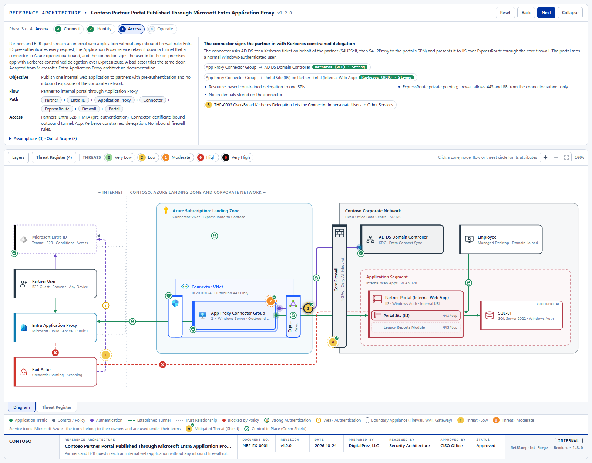
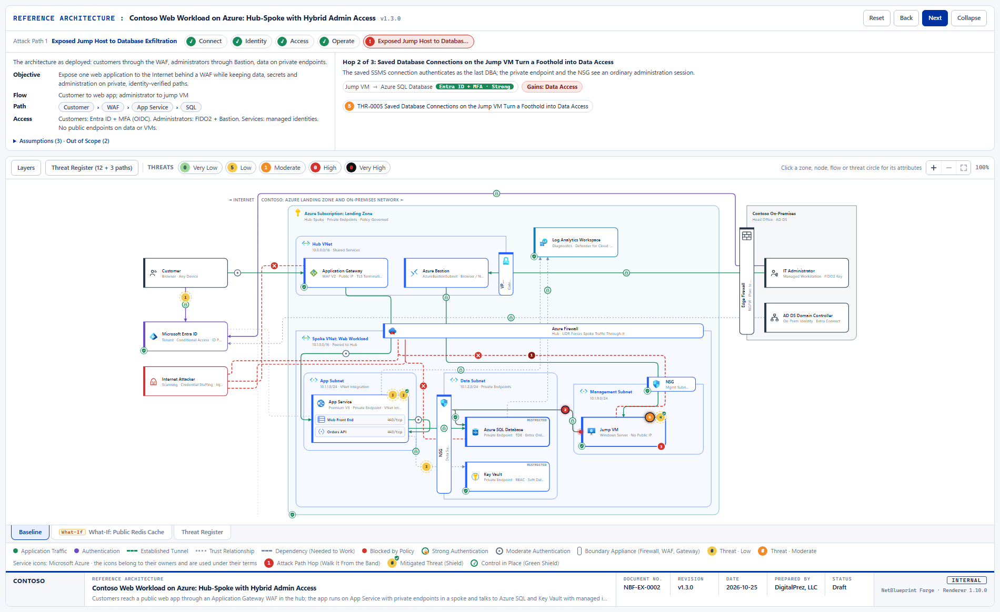
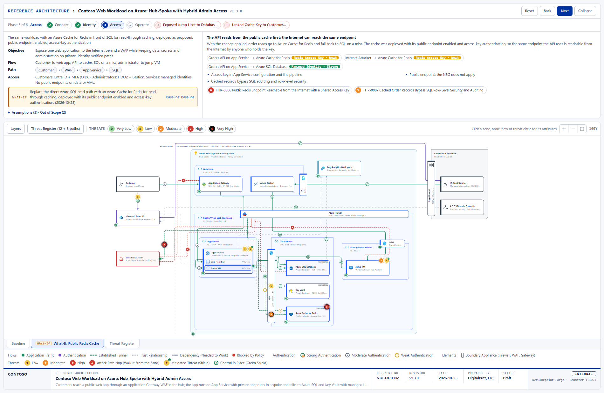
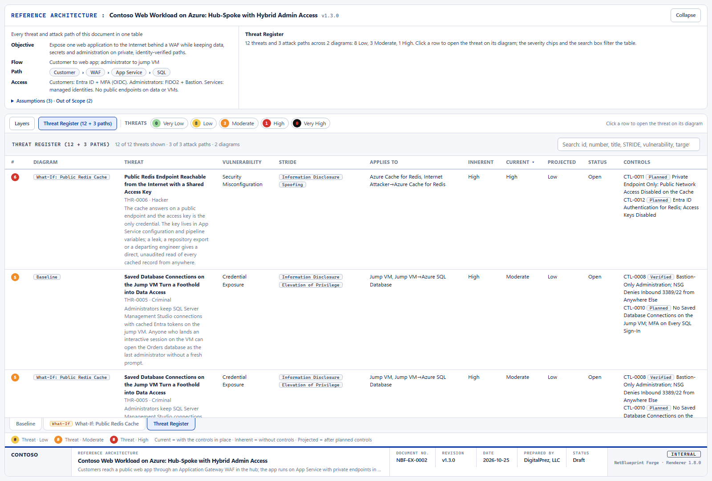
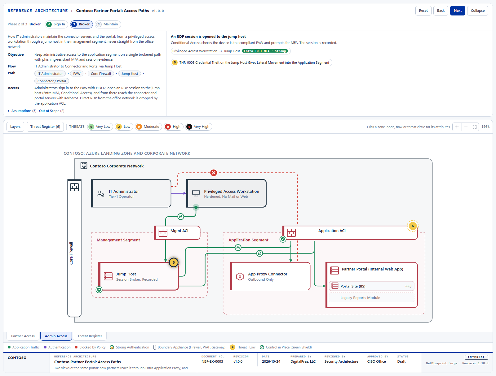

# NetBlueprint Forge

An AI skill that interviews you about a network or an application, builds a **context model** from your answers (zones and the appliances on their boundaries, nodes and the services on them, users, devices and bad actors, flows with their authentication strength and data classification, a guided step-by-step story, threats with full metadata, controls, attack paths, what-if scenarios) and renders it as a **self-contained, interactive HTML diagram** that you can mail, archive or open ten years from now.

The model is a JSON file your AI tool writes by name, never by coordinates; the renderer lays the diagram out, routes every line and checks its own geometry. One page can hold several diagrams of one system on tabs, and every page ends with a searchable Threat Register and a title-block signature footer.



*The primary example, [Contoso partner portal published through Microsoft Entra Application Proxy](examples/entra-app-proxy/README.md), opened at step 5 of its story. [Open the live page](https://bifrost.digitalprez.com/download/netblueprint-forge/entra-app-proxy/entra-app-proxy.html#step=5).*

The skill follows the open [Agent Skills](https://agentskills.io/specification) standard (a folder with a `SKILL.md`), so the same folder installs into Claude Code, Cursor and Kiro, and into the other tools that read the standard (OpenAI Codex / ChatGPT, GitHub Copilot, Gemini CLI, Windsurf; see [docs/PLATFORMS.md](docs/PLATFORMS.md)). Nothing leaves your machine: the scripts make no network calls, and a rendered page has no external dependency, not even a font or a logo.

## Contents

- [See it: the examples](#see-it-the-examples)
- [How it works](#how-it-works)
- [What a page offers](#what-a-page-offers)
- [Threats, risk, controls and attack paths](#threats-risk-controls-and-attack-paths)
- [Install](#install)
- [Use it](#use-it)
- [Sample usage, tool by tool](#sample-usage-tool-by-tool)
- [Quality checks](#quality-checks)
- [Documentation](#documentation)
- [Repository layout](#repository-layout)
- [Status](#status)
- [Branches](#branches)
- [Bugs and feature requests](#bugs-and-feature-requests)
- [License](#license)

## See it: the examples

Five documents ship with the skill, each adapted from a public reference architecture and set at the vendor's own sample organization: Microsoft's Contoso, AWS's AnyCompany, Google's Cymbal. Every page is one HTML file: the **live** links open it rendered, in your browser; the **source** links show the same file in the repository, where GitHub displays its markup (download it or clone to open it locally).

| Example | What it shows | Files |
| - | - | - |
| **Entra Application Proxy** (primary) | A partner reaches an internal web application with no inbound firewall rule: pre-authentication, an outbound connector tunnel, Kerberos constrained delegation over ExpressRoute, a bad actor trying the same door. Service profiles, full flow detail, 4 threats with as-is and future-state controls, out-of-scope elements drawn greyed. | [live](https://bifrost.digitalprez.com/download/netblueprint-forge/entra-app-proxy/entra-app-proxy.html) · [source](examples/entra-app-proxy/entra-app-proxy.html) · [model](examples/entra-app-proxy/entra-app-proxy.model.json) · [README](examples/entra-app-proxy/README.md) · [picture](docs/images/entra-app-proxy.png) |
| **Azure hub-spoke** (two tabs) | A web workload behind an Application Gateway WAF, App Service on private endpoints, Azure SQL and Key Vault, a jump VM behind Bastion, hybrid administration from on-premises. The **Baseline** tab carries attack path AP-0001 (exposed jump host to database exfiltration); the **What-If** tab evaluates a proposed public Redis cache and adds two threats, three planned controls and a second path. | [live](https://bifrost.digitalprez.com/download/netblueprint-forge/azure-hub-spoke/azure-hub-spoke.html) · [source](examples/azure-hub-spoke/azure-hub-spoke.html) · [model](examples/azure-hub-spoke/azure-hub-spoke.model.json) · [README](examples/azure-hub-spoke/README.md) · pictures: [attack path](docs/images/azure-hub-spoke-attack-path.png), [what-if](docs/images/azure-hub-spoke-whatif.png), [register](docs/images/threat-register.png) |
| **Partner Portal: Access Paths** (two tabs) | The same portal as two diagrams of one document: **Partner Access** and **Admin Access** (privileged access workstation, jump host, ACLs, a blocked direct path). Threat numbers continue across tabs and one register lists both. | [live](https://bifrost.digitalprez.com/download/netblueprint-forge/partner-portal-tabs/partner-portal-tabs.html) · [source](examples/partner-portal-tabs/partner-portal-tabs.html) · [model](examples/partner-portal-tabs/partner-portal-tabs.model.json) · [README](examples/partner-portal-tabs/README.md) · [picture](docs/images/partner-portal-admin-access.png) |
| **AnyCompany on AWS** | A three-tier web application in a VPC, from the AWS Architecture Center: CloudFront with AWS WAF, an Application Load Balancer in public subnets, EC2 in private subnets, RDS in isolated subnets, Secrets Manager, S3 and CloudWatch over VPC endpoints, Session Manager for administration. 6 threats, attack path AP-0001 from SSRF to exfiltration, AWS icons on every service, subnet and gateway. | [live](https://bifrost.digitalprez.com/download/netblueprint-forge/aws-three-tier/aws-three-tier.html) · [source](examples/aws-three-tier/aws-three-tier.html) · [model](examples/aws-three-tier/aws-three-tier.model.json) · [README](examples/aws-three-tier/README.md) · [picture](docs/images/aws-three-tier.png) |
| **Cymbal on Google Cloud** | A serverless web application, from the Cloud Architecture Center: an external HTTPS load balancer with Cloud Armor, Cloud Run services, a Serverless VPC Access connector to Cloud SQL and Memorystore, Secret Manager, Cloud Storage, Identity-Aware Proxy for the admin console, a VPC Service Controls perimeter. 6 threats, attack path AP-0001 from a poisoned dependency to customer data, Google Cloud icons. | [live](https://bifrost.digitalprez.com/download/netblueprint-forge/gcp-serverless-web/gcp-serverless-web.html) · [source](examples/gcp-serverless-web/gcp-serverless-web.html) · [model](examples/gcp-serverless-web/gcp-serverless-web.model.json) · [README](examples/gcp-serverless-web/README.md) · [picture](docs/images/gcp-serverless-web.png) |



*Attack path AP-0001 on the hub-spoke Baseline, hop 2 of 3. Each path is a red phase at the end of the walkthrough; Next walks its hops.*



*The What-If tab: the proposed Redis cache with its public endpoint, evaluated beside the untouched baseline. `scenario.mjs` prints the delta between the two.*

| Threat Register | A second tab of one document |
| - | - |
|  |  |
| Every threat and attack path of the document, across tabs, with inherent, current and projected ratings and the controls that apply. A row opens the threat on its diagram. | Admin Access, the second diagram of the Partner Portal document, at its Broker step. Tabs sit under the canvas; the register is always the last one. |

Every picture above is the whole page at the diagram's natural size, taken from the built examples by `tests/readme_screenshots.mjs` (see [Quality checks](#quality-checks)). Deep links open a page at a point, for a colleague or a picture: [the what-if tab at its cache step](https://bifrost.digitalprez.com/download/netblueprint-forge/azure-hub-spoke/azure-hub-spoke.html#tab=whatif-redis&step=6) (`#tab=whatif-redis&step=6`), [attack path AP-0001 at hop 2](https://bifrost.digitalprez.com/download/netblueprint-forge/azure-hub-spoke/azure-hub-spoke.html#path=AP-0001&hop=2) (`#path=AP-0001&hop=2`).

## How it works

Three artefacts, in this order:

1. **The conversation.** The skill runs a sectioned interview ([references/interview.md](skills/netblueprint-forge/references/interview.md)): what are we modelling, one diagram or several tabs, the network shape and its zones, the boundaries and their appliances, nodes and the services on them, users, devices and actors, flows and how each side authenticates, the story in phases and steps, threats and controls, attack paths, layers, then the summary and signature. Mandatory prompts are few (title and author, zones, nodes; for a threat: title, STRIDE, a target, adversary type, risk method and its inputs); everything else is optional and skippable. Typed answers are matched to option lists with `normalize.mjs` and confirmed when the match is unsure.

   Two other ways in: **ingest** Terraform, Bicep, CloudFormation, Kubernetes manifests, OpenAPI documents or a design document into proposed elements ([references/ingest.md](skills/netblueprint-forge/references/ingest.md)), and **what-if**: a proposed change becomes a scenario tab derived from the baseline, never an edit of it ([references/what-if.md](skills/netblueprint-forge/references/what-if.md)).

2. **The model** (`model.json`), validated against a [JSON Schema](skills/netblueprint-forge/assets/schema/netblueprint.schema.json) and a cross-reference lint. Names are ids and every reference is by name; there are no coordinates, only optional layout hints. Abridged from the examples (the attack path comes from the hub-spoke document):

   ```json
   {
     "meta": { "title": "Contoso Partner Portal Published Through Microsoft Entra Application Proxy", "author": "DigitalPrez, LLC", "version": "1.2.0" },
     "zones": [
       { "name": "connector-vnet", "label": "Connector VNet", "parent": "azure", "kind": "vpc",
         "appliances": [ { "name": "nsg-connectors", "label": "NSG", "type": "firewall", "edge": "left", "serves": ["internet"] } ] }
     ],
     "nodes": [
       { "name": "partner", "label": "Partner User", "type": "remote-user", "zone": "internet" },
       { "name": "portal-app", "label": "Partner Portal (Internal Web App)", "type": "host", "zone": "app-segment",
         "components": [ { "name": "web", "label": "Portal Site (IIS)" }, { "name": "reports", "label": "Legacy Reports Module" } ] }
     ],
     "flows": [
       { "name": "f-employee-app", "label": "Internal Access", "from": "employee", "to": "portal-app/web", "kind": "data",
         "auth": "kerberos", "protocol": "HTTPS", "port": "443/tcp", "encrypted": true,
         "data_classification": "restricted", "data_tags": ["pii"] }
     ],
     "steps": [
       { "name": "request", "phase": "connect", "title": "A partner opens the portal's external address",
         "flows": ["f-partner-proxy"], "highlight": ["partner"] }
     ],
     "threats": [
       { "id": "THR-0001", "number": 1, "title": "Credential Stuffing and MFA Fatigue Against Partner Accounts", "status": "open",
         "classification": { "stride": ["spoofing"] }, "targets": [ { "kind": "flow", "ref": "f-attacker-entra" } ],
         "risk": { "method": "likelihood-impact", "likelihood": "high", "impact": "high",
                   "residual": { "method": "likelihood-impact", "likelihood": "low", "impact": "high" } },
         "treatment": { "decision": "mitigate", "controls": ["CTL-0001", "CTL-0002"] } }
     ],
     "controls": [
       { "id": "CTL-0001", "name": "Conditional Access: MFA and No Legacy Auth for B2B Guests", "type": "preventive", "status": "verified",
         "implemented_on": [ { "kind": "node", "ref": "entra-id" } ], "nist_800_53": ["IA-2(1)"] }
     ],
     "attack_paths": [
       { "id": "AP-0001", "number": 1, "title": "Exposed Jump Host to Database Exfiltration",
         "hops": [ { "threat": "THR-0004", "via": "f-attacker-jump", "to": "jump-vm", "gain": "foothold" },
                   { "threat": "THR-0005", "via": "f-jump-sql", "to": "sql", "gain": "data-access" } ],
         "breaks_at": ["CTL-0008", "CTL-0010"] }
     ]
   }
   ```

   Every field, its allowed values and its rules are in the generated [model reference](skills/netblueprint-forge/references/model-reference.md). Node types: server, host, service, database, storage, api, connector, saas, public-endpoint, user, remote-user, admin, bad-actor, laptop, workstation, mobile, iot, ot, identity-provider, generic. A model can be one diagram or `tabs[]`, each tab with its own collections; a scenario tab names its baseline and the change.

3. **The page** (`<model-name>.html`), built by `build.mjs` from the [renderer template](skills/netblueprint-forge/assets/template/template.html) with the model embedded. The renderer places zones, nodes and appliances, locks partners of the story onto common centre lines, routes every line with an orthogonal visibility-graph search under a written precedence (no line through a box, none over text, glyphs on clear spans, bars crossed where the search decides), then checks its own geometry. How and why is in [docs/research/layout-routing.md](docs/research/layout-routing.md) and [references/layout-hints.md](skills/netblueprint-forge/references/layout-hints.md).

Models are revised by name: archive first (`archive.mjs` snapshots the model and page, bumps the version, opens a changelog entry), edit, validate, build, log the diff. Threat and attack-path numbers are permanent: retired, never deleted or renumbered.

## What a page offers

- **The band** at the top: title and version, Reset / Back / Next, the phase chips (attack paths are red ones at the end), the document summary (objective, flow, path, access, assumptions, out of scope) and the current step with its flows and their authentication strength. Collapse shrinks it to one strip.
- **The canvas**: zones with their boundary appliances drawn as bars on the edge they guard, nodes with their components, cloud services with their vendor's official icon (Azure, AWS and Google Cloud icons ship with the skill), other products with their logo when one was fetched for the model (Fortinet, Palo Alto, Sophos, Check Point and the rest of the Dashboard Icons collection), Internet-side actors on the left, flows as orthogonal lines that leave the initiator, an auth badge on every flow (lock = strong, dot = moderate, ! = weak or none, ? = unspecified), a red ✕ on paths blocked by design, numbered threat circles on their targets (a mitigated one carries a small green shield), green shields where controls are in place, red numbered hop markers while an attack path is walked. Out-of-scope elements stay on the diagram, greyed.
- **Click** any zone, node, component, appliance, flow, threat circle or hop and the **Attributes card** opens: a floating, draggable card listing every attribute, with a filter box; a threat click also highlights its targets. **Hover** anything for a styled bubble with the essentials.
- **Layers card**: built-in layers (zones, boundary appliances, nodes, components, the Internet side, each flow strength, blocked paths, trust relationships, threat markers, control badges, auth badges) and the model's own layers (an "illustrative threats" layer in the examples hides the threats for a plain architecture view), with dependencies between them.
- **Threat Register**: the last tab of every document. One sortable, searchable table of every threat and every attack path across the diagrams, with inherent, current and projected ratings; the severity chips in the toolbar filter it and hide bands on the canvas. A row opens the element on its diagram.
- **Tabs** under the canvas when the model has several diagrams; a what-if tab carries a What-If tag and opens with the change statement and a link back to its baseline.
- **Keyboard and links**: ← → step, R resets, C collapses the band, Esc clears a selection, PageUp / PageDown switch tabs; Ctrl+wheel, double-click and drag zoom and pan. `#tab=<name>`, `&step=<n or name>` and `&path=AP-nnnn&hop=<n>` in the URL open the page at a point.
- **Legend and signature block**: the legend lists only what the model uses; the title block shows organization and logo, title, document number, revision, date, prepared / reviewed / approved by, status and classification.

The full list, including what to check after a build and how to fix what you see, is [references/render.md](skills/netblueprint-forge/references/render.md).

## Threats, risk, controls and attack paths

- **A threat** has a permanent id and number, a title, STRIDE categories and ATT&CK tactics, a vulnerability category with its CWE, targets (nodes, flows, zones, appliances, components), the boundary it crosses, the assets and data at risk, an adversary profile (type, source class, motivation, capability, resources, position, access vector), standards mappings (CWE, OWASP, NIST SP 800-53, CIS Controls, compliance clauses) and a treatment: mitigate, accept, transfer or avoid, with the controls in place, the controls planned and suggested mitigations written as engineering actions. The catalogue of questions and options is [references/threats.md](skills/netblueprint-forge/references/threats.md).
- **Three ratings, current first.** The skill asks for the controls already in place, rates the risk with them (`risk.residual`, shown on the canvas), then without them (`risk`, inherent), then after the planned controls (`risk.projected`). The user picks the method per threat: Likelihood × Impact, OWASP Risk Rating or CVSS ([references/risk-scoring.md](skills/netblueprint-forge/references/risk-scoring.md)); `validate.mjs --fix` writes the computed rating and score back and flags a rating that contradicts its inputs.
- **Controls** are their own objects referenced by id: type (preventive, detective, corrective …), status (planned, implemented, verified, with the verification and its date), effectiveness, owner, where they are implemented, NIST and CIS mappings. A mitigated threat needs an implemented control; an accepted one needs an acceptance record; the validator enforces both.
- **Attack paths** chain threats into a cascade: each hop names the threat, the flow it rides, where it lands, what the adversary gains (foothold, credentials, token, session, network access, code execution, data access, data exfiltration, privilege, persistence, lateral movement, denial of service, impact), the controls it bypasses and a note; the path carries its entry point, impact, assets at risk, its own three ratings, the controls that break it and the ATT&CK techniques. The validator checks that the chain is continuous and that each hop's threat is relevant to where it lands.
- **Two lints raise the floor:** every flow that is not a trust relationship or blocked carries a data classification, and every open threat has a control or a suggested mitigation an engineer can build.
- **Cloud services.** When a node is an AWS, Azure or GCP service, the skill loads its card (12 per provider: compute, storage, databases, serverless, Kubernetes, messaging, secrets and keys, edge and WAF, administration brokers) and asks the card's exposure questions; proposed zones, nodes and threats stay marked `suggested` until confirmed. Each card also carries the service's official icon, which the page shows beside the node's label. Cards: [references/cloud](skills/netblueprint-forge/references/cloud/README.md); research: [docs/research/cloud-service-catalogue.md](docs/research/cloud-service-catalogue.md).

## Install

**Requirements.** An AI tool that reads Agent Skills: Claude Code, Cursor or Kiro, or another tool listed in [docs/PLATFORMS.md](docs/PLATFORMS.md); Node.js 18 or later for the scripts (no `npm install`, there are no dependencies); any browser to open the pages. Optional: Chrome, Chromium or Brave on the machine for the headless geometry check and the PNG export (Microsoft Edge on Windows hands the page to its running instance and prints nothing, so prefer Chrome there); Python 3 with `jsonschema` only for the schema development test.

**Link the skill into a project or your user profile** (the scripts create links to `skills/netblueprint-forge/` in `.agents/skills/`, `.claude/skills/` and `.kiro/skills/`, which covers every tool above):

```powershell
git clone https://github.com/digitalprezllc/netblueprint-forge.git
cd netblueprint-forge
.\platforms\install.ps1                       # this repository
.\platforms\install.ps1 -Global               # your user profile (~/.agents, ~/.claude, ~/.kiro)
.\platforms\install.ps1 -Target C:\path\to\your\project
```

```bash
git clone https://github.com/digitalprezllc/netblueprint-forge.git
cd netblueprint-forge
./platforms/install.sh                        # this repository
./platforms/install.sh --global               # your user profile
./platforms/install.sh /path/to/your/project
```

`-Copy` / `--copy` copies instead of linking; `-Uninstall` / `--uninstall` removes the links. Or copy the `skills/netblueprint-forge` folder yourself into the folder your tool reads; it carries its own LICENSE.

**Claude Code plugin:**

```text
/plugin marketplace add digitalprezllc/netblueprint-forge
/plugin install netblueprint-forge@netblueprint
```

**From a release zip.** `netblueprint-forge-<version>.zip` is one folder, `netblueprint-forge/`, with SKILL.md, LICENSE, references, scripts and assets inside. Download it from [bifrost.digitalprez.com/download/netblueprint-forge/releases/](https://bifrost.digitalprez.com/download/netblueprint-forge/releases/) (current: [netblueprint-forge-0.7.0.zip](https://bifrost.digitalprez.com/download/netblueprint-forge/releases/netblueprint-forge-0.7.0.zip)), or from the repository's [Releases page](https://github.com/digitalprezllc/netblueprint-forge/releases). Upload it as a custom skill in claude.ai or through the Claude API, or unzip it into the folder your tool reads. The release number is the skill version; [CHANGELOG.md](CHANGELOG.md) says what each one holds, and `node platforms/package.mjs` builds the same archive, byte for byte, from any checkout of that version.

## Use it

Ask your AI tool in plain words:

- "Use netblueprint-forge to model the payments network."
- "What if we put a Redis cache in front of the orders database with a public endpoint?" (a what-if tab beside the baseline)
- "Add a second web server `web-02` in `snet-app` and a flow from the gateway to it." (archive, edit by name, rebuild)

The skill writes `netblueprint/<model-name>/model.json`, builds `netblueprint/<model-name>/<model-name>.html` next to it and keeps `archive/` with every earlier revision and a changelog. The scripts can also be run by hand, from the skill folder:

| Command | Does |
| - | - |
| `node scripts/validate.mjs <model.json> --fix` | Schema check plus cross-reference lint; writes computed ratings and Title Case labels back. Exit 1 on errors. |
| `node scripts/build.mjs <model.json>` | Validates, then renders `<model-name>.html` next to the model. Refuses a model with errors. |
| `node scripts/archive.mjs <model.json> --note "…"` / `--diff` | Snapshot and version bump before an edit; element-level changelog entry after it. |
| `node scripts/scenario.mjs <model.json> --tab <what-if tab>` | The delta of a what-if tab against its baseline, as Markdown (`--json` for data). |
| `node scripts/check.mjs <page.html>` | Headless geometry check of every tab (needs a Chromium-based browser). |
| `node scripts/screenshot.mjs <page.html> --tab <name> --step <n>` | A PNG of one view, whole page at natural size, for a document or a deck. |
| `node scripts/normalize.mjs <field> "<typed text>"` | Maps an answer onto an option list (STRIDE, bands, protocols …); `--fields` lists the fields. |

Details in [scripts/README.md](skills/netblueprint-forge/scripts/README.md).

## Sample usage, tool by tool

The skill is the same folder in every tool; only the way you call it differs. Each sample follows one scenario path: what you want, what you say, which interview sections carry it, what the page shows, and the next move. Output lands in `netblueprint/<model-name>/` in your project whichever tool you use.

| Tool | How to call it |
| - | - |
| Claude Code | automatic on intent, or `/netblueprint-forge` |
| Cursor | automatic, or `/netblueprint-forge` |
| Kiro | automatic, or `/netblueprint-forge` |

Other tools that read Agent Skills (OpenAI Codex / ChatGPT, GitHub Copilot, Gemini CLI, Windsurf) use the same folder; their invocation forms are in [docs/PLATFORMS.md](docs/PLATFORMS.md).

### Claude Code: a payments data flow for a PCI scoping review

Card data enters at a checkout page, crosses a WAF and an API gateway, is tokenized by a vault service and leaves to a payment processor. The reviewer wants one page that shows where cardholder data travels, how every hop authenticates, and who can administer the servers.

```text
You:    Use netblueprint-forge to draw the data flow of our payments API for a PCI scoping review:
        cardholder data from the checkout page to the processor, where it is tokenized, and who can administer it.

Skill:  New model. Title and author? … Zones first: I propose Internet, Edge (WAF and API gateway), Application,
        Data and Management; keep, rename or add? … Which appliance guards each zone edge? …
        The vault is Azure Key Vault? Then its card's questions: public or private endpoint, who has data-plane
        access, soft delete and purge protection? …
        Flow checkout-page → api-gateway: how does the client authenticate, what does it carry, how sensitive is it?
```

- **Interview path:** Sections 1 and 2 fix the trust domains and the appliances on their edges; Section 3 adds the API, the vault and the processor as a SaaS node marked out of scope; Section 5 records each flow's authentication and classifies it (`restricted`, tagged `pci`); Section 6 tells the story in phases; Section 7 raises the threats the crossings suggest.
- **The page:** the band's Path line reads Customer › WAF › API Gateway › Payments API › Token Vault › Processor; lock badges on the mTLS and OAuth hops, a red ✕ on the direct path the gateway blocks, `RESTRICTED` on the data stores, the processor greyed, and the first findings in the Threat Register.
- **Next:** "What if tokenization moves in front of the gateway?" opens a what-if tab beside the baseline; `scenario.mjs` prints the delta.

### Cursor: a second tab added to an existing model

The portal model `hr-portal` exists; operations wants a view of how administrators reach the servers from the office network.

```text
You:    /netblueprint-forge add a tab admin-access to hr-portal: how operators reach the portal servers from the office.

Skill:  Archived v1.2.0 -> now v1.3.0 (note: add the admin-access tab). The new tab has its own zones, nodes, flows
        and steps; threat numbers continue at THR-0007. Who are the operators, and from which device? …
        Is the direct RDP path from the office blocked or allowed? Blocked paths are drawn with a ✕. …
        Built hr-portal.html: two diagram tabs and the Threat Register; the geometry check passed on both.
        Logged to archive/CHANGELOG.md: +1 tab, +3 zones, +4 nodes, +5 flows, +4 steps, +2 threats, +3 controls.
```

- **Interview path:** [revise and archive](skills/netblueprint-forge/references/revise-and-archive.md): archive first, Section 0b for the tab, the usual sections for its contents, validate with `--fix`, build, log the diff. Every edit is by name.
- **The page:** a tab strip under the canvas, the new tab with its own phases (Sign In, Broker, Maintain), the jump host behind its own ACL, and one register across both tabs, as in the [Partner Portal example](examples/partner-portal-tabs/README.md).
- **Next:** `hr-portal.html#tab=admin-access&step=2` is the link to send the operators' lead.

### Kiro: a what-if scenario beside a baseline

An analytics vendor asks for a public endpoint on the orders database. Nobody wants to edit the baseline to find out what that would cost.

```text
You:    /netblueprint-forge what if the orders database gets a public endpoint for the analytics vendor?

Skill:  Deriving the scenario tab whatif-public-db from main (archived v1.4.0 -> now v1.5.0). The change, in one
        sentence? … The vendor: an actor on the Internet side; how does it authenticate to the database? …
        Re-running the threats on the change: a new boundary crossing (Internet → Data), a weakened flow
        (SQL login over the Internet), two threats, one attack path to the orders data. Keep them? …
        Delta: +1 node, +1 flow, +2 threats, +1 attack path; CTL-0003 (private endpoint only) is invalidated.
```

- **Interview path:** [what-if](skills/netblueprint-forge/references/what-if.md): the scenario tab names its baseline and the change, repeats only what the change touches, and re-runs threats and attack paths on it; the baseline stays untouched.
- **The page:** a What-If tag on the tab, a banner with the change statement and a link back to the baseline, the vendor's weak-auth flow with a `!` badge, new threat circles on the database, and the new path as a red phase.
- **Next:** promote the scenario into the baseline once the change is approved, or drop the tab; either way `scenario.mjs` has written the delta.

## Quality checks

Five checks, each one command, all run by CI on every push and pull request to `develop` and `master` ([.github/workflows/checks.yml](.github/workflows/checks.yml)):

| Check | Command | Covers |
| - | - | - |
| Validator suite | `node tests/check_validate.mjs` | Every fixture and example through `validate.mjs`: the `invalid-*` fixtures must fail with the expected errors, the rest must pass; spot checks of the risk computation. |
| Schema check | `python -I tests/check_schema.py` | The fixtures against the JSON Schema itself (needs `pip install jsonschema`). |
| Layout check | `node tests/check_layout.mjs` | Builds the examples, opens every diagram tab headless and fails when a line passes through or hugs a box it does not touch, runs over text, clashes with a glyph, jogs, shares a lane or could not be routed; compares crossings and bends with `tests/layout-baseline.json`. CI runs it with `--hard-only` because the baseline depends on the machine's fonts; `--font "DejaVu Sans"` previews what the Linux runner sees. |
| Icon check | `node tests/check_icons.mjs` | The vendor icon library and its use, without a browser: the index files, every cloud card's icon, every example's icons and the symbols in its built page, the normalizer, and the fetch path for product logos (offline, from a folder). |
| Packaging check | `node tests/check_package.mjs` | Builds the release zip twice, from the skill folder and from a copy with other file times, and requires the same bytes; then reads the archive back and compares every entry with the folder: names, order, one fixed time, CRC, content. |

The Actions tab of the repository shows each run. Two more workflows: [release.yml](.github/workflows/release.yml) packages the skill and publishes a GitHub Release when a merge to `master` raises the skill version; [pull-requests.yml](.github/workflows/pull-requests.yml) closes a pull request from outside the organization on arrival with a note, since the repository takes reports and not code ([CONTRIBUTING.md](CONTRIBUTING.md)). `node tests/readme_screenshots.mjs` regenerates the pictures in this README from the built examples. All of it is described in [tests/README.md](tests/README.md).

## Documentation

- [docs/REQUIREMENTS.md](docs/REQUIREMENTS.md): the agreed scope, section by section, with what is in version 1 and what comes later.
- [docs/DECISIONS.md](docs/DECISIONS.md): every design decision with its reasons, D1 to D40.
- [docs/PLATFORMS.md](docs/PLATFORMS.md): which tool reads which folder, how to invoke the skill in each, platform-specific extras.
- Research notes: [threat attributes](docs/research/threat-attributes.md), [service, flow and threat detail](docs/research/service-flow-threat-attributes.md), [cloud service catalogue](docs/research/cloud-service-catalogue.md), [layout and routing](docs/research/layout-routing.md).
- The skill's own references, loaded on demand by [SKILL.md](skills/netblueprint-forge/SKILL.md): [interview](skills/netblueprint-forge/references/interview.md), [threats](skills/netblueprint-forge/references/threats.md), [risk scoring](skills/netblueprint-forge/references/risk-scoring.md), [what-if](skills/netblueprint-forge/references/what-if.md), [ingest](skills/netblueprint-forge/references/ingest.md), [revise and archive](skills/netblueprint-forge/references/revise-and-archive.md), [render](skills/netblueprint-forge/references/render.md), [layout hints](skills/netblueprint-forge/references/layout-hints.md), [icons](skills/netblueprint-forge/references/icons.md), [model reference](skills/netblueprint-forge/references/model-reference.md), [cloud cards](skills/netblueprint-forge/references/cloud/README.md).
- [tests/README.md](tests/README.md): the checks, the fixtures and the numbers behind the layout baseline.
- [CHANGELOG.md](CHANGELOG.md): what each release holds; the release number is the skill version.
- [THIRD-PARTY-NOTICES.md](THIRD-PARTY-NOTICES.md): the terms under which the Microsoft, AWS and Google icons in the skill's icon library, and the product logos it can fetch from Dashboard Icons, are used.
- [CONTRIBUTING.md](CONTRIBUTING.md): bug reports and feature requests are welcome, pull requests are not accepted, and why.
- [SECURITY.md](SECURITY.md): how to report a vulnerability privately, and what counts as one here.

## Repository layout

```text
netblueprint-forge/
├── skills/netblueprint-forge/     The skill. This folder is what gets installed; it carries its own LICENSE.
│   ├── SKILL.md                   Router: what the skill does and which reference to load for which request
│   ├── references/                Interview, threats, risk scoring, what-if, ingest, layout hints, render, model reference, icons, cloud cards
│   ├── scripts/                   validate · build · archive · normalize · scenario · check · screenshot · model-reference (Node.js, no dependencies)
│   ├── assets/schema/             JSON Schema for the context model (draft 2020-12)
│   ├── assets/icons/              The vendor icon library: Azure (with Entra), AWS, Google Cloud, one index per provider
│   ├── assets/template/           The HTML renderer
│   ├── assets/examples/           Copies of the example models
│   └── agents/openai.yaml         Codex / ChatGPT display metadata
├── examples/                      The example models, their rendered pages and a README each
├── docs/                          Requirements, decisions, platform matrix, research notes, the pictures in this README
├── platforms/                     Install scripts for Windows (install.ps1) and macOS / Linux (install.sh); package.mjs builds the release zip
├── tests/                         Validator suite, schema check, layout check with its baseline, icon check, packaging check, README pictures
├── blueprints/                    Working models produced with the skill in this repository
├── .claude-plugin/                Plugin and marketplace manifests for Claude Code
├── .github/ISSUE_TEMPLATE/        Bug report and feature request forms; blank issues are off; the pull request notice sits beside them
├── .github/workflows/             checks.yml runs the five checks on every push and pull request; release.yml publishes the zip from master; pull-requests.yml closes outside pull requests
├── CHANGELOG.md                   What each release holds
├── CONTRIBUTING.md                Bug reports and feature requests are welcome; pull requests are not accepted
├── LICENSE                        PolyForm Noncommercial 1.0.0 with DigitalPrez's additional terms
├── SECURITY.md                    How to report a vulnerability privately
└── THIRD-PARTY-NOTICES.md         The vendors' terms for the icon library
```

## Status

Skill 0.7.0, renderer 1.8.0. Usable for real models; the five examples, three on Azure and one each on AWS and Google Cloud, are rendered from their models and pass every check. Done so far: the interview with its references and option lists; the JSON Schema, the validator with its lint and `--fix`, the archive workflow; service profiles, flow detail and threat detail from the research notes; the cloud catalogue (36 cards); multi-tab documents with one Threat Register; floating Layers and Attributes cards; Title Case labels and arrows that leave the initiator; the title-block footer; the visibility-graph router with a written precedence and the page's self-check; automated layout checks with a baseline; attack paths walked on the canvas; what-if scenario tabs with a delta script; classification and remediation lints; the ingest guide; deep links and PNG export; CI; the official Azure, AWS and Google Cloud icons on cloud elements and product logos fetched on demand for everything else. Published on GitHub with `develop` as the default branch and `master` protected; a merge to `master` that raises the skill version becomes a release with its zip; bug reports and feature requests come in through issue forms, and pull requests are not accepted. The scope is in [docs/REQUIREMENTS.md](docs/REQUIREMENTS.md) and the choices made along the way in [docs/DECISIONS.md](docs/DECISIONS.md).

## Branches

`master` is the released state; `develop` is where work lands and the branch to check out. Changes go through `develop` and reach `master` only by merging `develop` into it (a release), never the other way round and never by committing to `master` directly. On GitHub, set the default branch to `develop` and protect `master`.

## Bugs and feature requests

Reports are welcome, code is not. Open a [bug report](https://github.com/digitalprezllc/netblueprint-forge/issues/new?template=bug_report.yml) for something the skill, a script or a page does wrong, or a [feature request](https://github.com/digitalprezllc/netblueprint-forge/issues/new?template=feature_request.yml) for something you wish it did, and describe the behaviour or the need; the fix is written here. Pull requests are not accepted and are closed on arrival, so that every line stays DigitalPrez's and the commercial licence stays simple; [CONTRIBUTING.md](CONTRIBUTING.md) says more. A vulnerability goes to [SECURITY.md](SECURITY.md), not to an issue. Keep real names and anything else from a real model out of an issue: it is visible to everyone who can see the repository.

## License

Copyright (c) 2025-2026 DigitalPrez, LLC. All rights reserved. NetBlueprint Forge is source-available under the [PolyForm Noncommercial License 1.0.0](LICENSE) with additional terms from DigitalPrez:

- **Noncommercial use is free**: evaluate it, learn from it, use it for personal projects and non-profit work, modify it, as long as the notices stay.
- **Commercial use needs a written license** from DigitalPrez, LLC, granted to specific organizations with or without a fee. Ask at subscriptions@digitalprez.com; the grant is a one-page document, provided on request, that can cover a company and its subsidiaries.
- **Everything the skill produces is free to use**: the models you write and the diagrams rendered from them are yours, and the copy of the renderer inside each diagram carries an output exception so anyone may open and share them.
- "NetBlueprint Forge" and "DigitalPrez" are trademarks of DigitalPrez, LLC.

NetBlueprint Forge is built and maintained by DigitalPrez, LLC, in business since 1998. Licensing questions go to subscriptions@digitalprez.com. A copy of the LICENSE sits inside the skill folder so an installed skill carries it.
